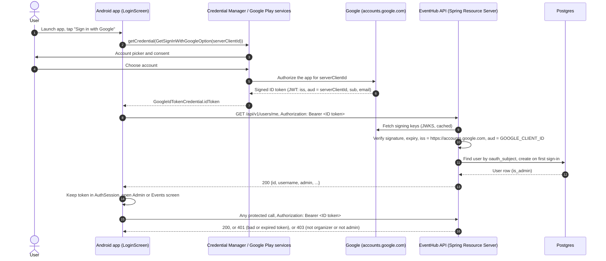
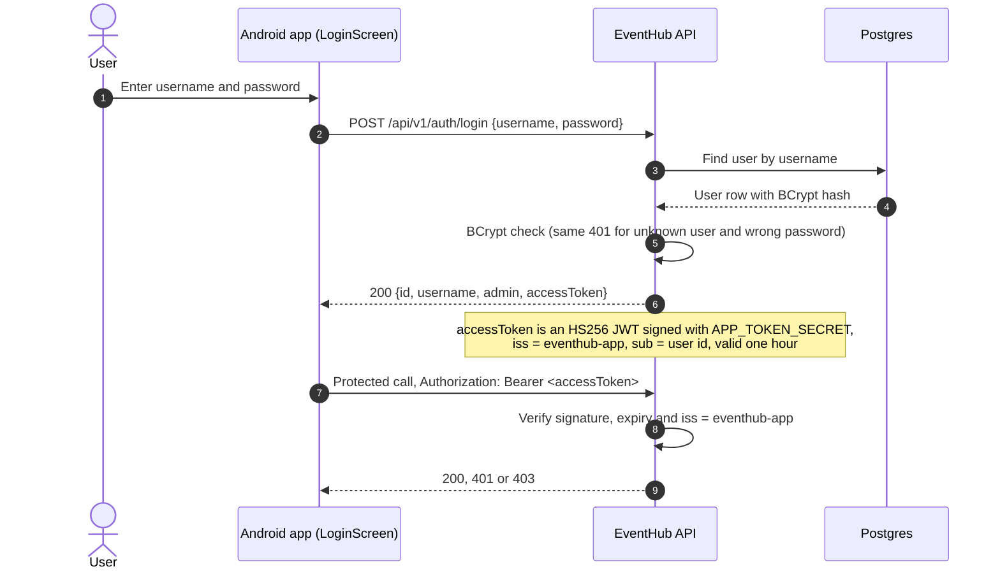

# Auth sequence

How a user gets from app launch to an authorized API call. The app has two sign-in paths, and both
end with a Bearer token that the API validates as an OAuth2 Resource Server (no sessions, no cookies).
Why Google and Credential Manager: [ADR 0002](adr/0002-auth-google-resource-server.md).

## Sign in with Google

## Username and password

## Logout

The app drops the token from `AuthSession` and returns to the login screen. Tokens are stateless, so
the API keeps no session to end; a token simply stops working when it expires.
