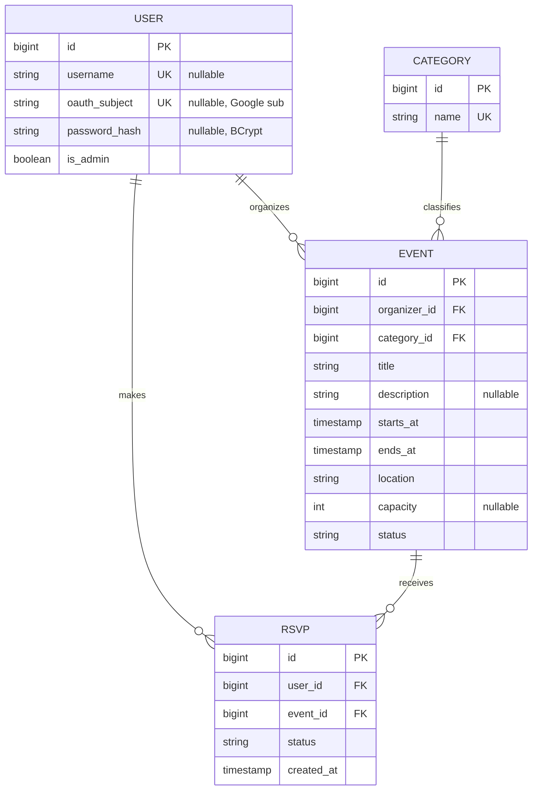

# EventHub Proposal

## 1. The pitch (one paragraph)
EventHub is an API and Android app for finding and organizing events such as meetups, concerts,
workshops and campus activities. Organizers create events, choose a category, set a time, place and
optional capacity, and publish them when they are ready. Anyone can browse published events without
an account, filtering by category and start date. Signed-in users can RSVP as going, maybe or
declined, and organizers can see who responded. Admins manage categories and can remove any event
to keep the platform clean. The Spring Boot (Kotlin) API is backed by PostgreSQL, uses Google
sign-in for authentication, and is described by an OpenAPI contract in `docs/openapi.yaml`.

## 2. Resources
| Resource | Key fields                                                                                                     | Relationships                                                                    |
|----------|----------------------------------------------------------------------------------------------------------------|----------------------------------------------------------------------------------|
| User     | id, username (unique), oauthSubject (Google `sub`, unique, nullable), passwordHash (nullable), isAdmin         | Organizes many events. Makes many RSVPs.                                         |
| Event    | id, title, description, startsAt, endsAt, location, capacity (nullable), status (DRAFT/PUBLISHED/CANCELLED)    | Belongs to one organizer (User) and one Category. Has many RSVPs.                |
| Category | id, name (unique)                                                                                              | Classifies many events. Cannot be deleted while an event uses it.                |
| RSVP     | id, userId, eventId, status (GOING/MAYBE/DECLINED), createdAt                                                  | Belongs to one user and one event. A user has at most one RSVP per event.        |

## 3. ER sketch
Tables, primary and foreign keys, and cardinality (renders on GitHub; try changes at https://mermaid.live):

## 4. Endpoints
Auth is `public` (no token), `user` (any signed-in user), `organizer` (user who owns the event) or `admin`.
The only paginated collection is `GET /events` (`page`, `size`, filters `category` and `from`, `sort`, default `startsAt`).

| Verb   | Path                                                         | Auth      | Purpose                                                          |
|--------|--------------------------------------------------------------|-----------|------------------------------------------------------------------|
| POST   | /api/v1/auth/register                                        | public    | create a username/password account                               |
| POST   | /api/v1/auth/login                                           | public    | check a username and password                                    |
| GET    | /api/v1/events?page=0&size=20&category=&from=&sort=startsAt  | public    | list published events (**paginated**; filters: category, from)   |
| GET    | /api/v1/events/{id}                                          | public    | event details                                                    |
| POST   | /api/v1/events                                               | user      | create an event (caller becomes organizer)                       |
| PUT    | /api/v1/events/{id}                                          | organizer | replace my event                                                 |
| PATCH  | /api/v1/events/{id}                                          | organizer | change some fields of my event                                   |
| DELETE | /api/v1/events/{id}                                          | organizer | delete my event                                                  |
| GET    | /api/v1/users/me                                             | user      | identity from the token                                          |
| GET    | /api/v1/users/me/events                                      | user      | events I organize (all statuses)                                 |
| POST   | /api/v1/events/{id}/rsvps                                    | user      | RSVP to an event (409 if duplicate or event is full)             |
| DELETE | /api/v1/events/{id}/rsvps                                    | user      | cancel my RSVP                                                   |
| GET    | /api/v1/events/{id}/rsvps                                    | organizer | attendee list                                                    |
| GET    | /api/v1/categories                                           | public    | list categories                                                  |
| POST   | /api/v1/categories                                           | admin     | create a category                                                |
| DELETE | /api/v1/categories/{id}                                      | admin     | delete a category (409 while in use)                             |
| DELETE | /api/v1/admin/events/{id}                                    | admin     | remove any event (moderation)                                    |
| GET    | /api/v1/health                                               | public    | liveness check                                                   |

## 5. Technical choices
- **Database host:** Neon PostgreSQL. We chose Neon because it provides a managed PostgreSQL database that our backend can use without us running the database server ourselves. Local development uses a throwaway Postgres 17 container from `docker-compose.yml`, so nobody needs Neon credentials to run the project.
- **OAuth2 provider:** Google. Google supports the OAuth 2.0 Authorization Code flow, and PKCE can be used with native/mobile applications. Our Android app signs in with Google (Credential Manager) and sends the resulting ID token as a Bearer token. The API validates the token's issuer and checks that its audience is our Google client ID. A local user row is created on first use. Username/password accounts (BCrypt-hashed) also exist for sign-up and login.
- **Repo layout:** Monorepo. The Android app lives in `/app` and the Spring Boot API in `/backend`, in one Gradle build. This keeps the project in one place and makes it easier for the team to coordinate changes between the Android application and the API. The API's Docker image builds without the Android SDK.
- **Deployment and CI:** The API ships as a Docker image built by GitHub Actions and pushed to GHCR on merges to `main`. Pull requests run Android unit tests and build, build the Docker image, and lint `docs/openapi.yaml`.
## 6. Risks
The two things most likely to go wrong, and what we will do first to find out.
- **Authentication and authorization:** OAuth2 and user roles may not work correctly between the Android app and backend. We will first test the login flow with a basic authenticated API request and verify that USER and ADMIN permissions are enforced correctly.
- **Event and RSVP data:** Relationships between users, events, categories, and RSVPs could cause database or API issues. We will first create the database tables and test creating an event and submitting an RSVP to verify that the relationships and constraints work correctly.
## 7. Team and Sprint 1
Who owns what in Sprint 1.

### Sprint 1 Ownership

- **Victor Borba:** UserDAO, UserEntity, and database setup
- **Linus Schaub:** Sign-up
- **Justin Tzeng:** Login page
- **Hugo Ruiz-Mireles:** GitHub Actions and CI setup
- **Project board:** https://github.com/users/Hugo-RM/projects/3/views/1
- **Sprint 1 milestone:** https://github.com/Hugo-RM/cst438-project-2/milestones
 